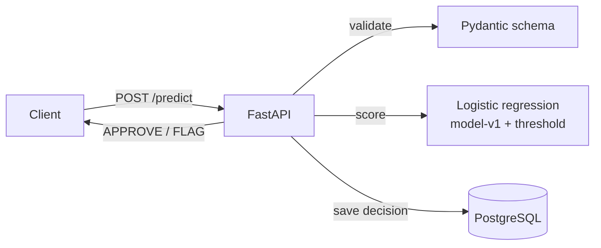

# Fraud Detection API


A FastAPI service that scores credit card transactions for fraud with a scikit-learn model
and stores every decision in PostgreSQL.

## How it works



1. A client sends a transaction (`v1`–`v28`, `amount`) to `POST /predict`.
2. The request is validated.
3. The model gives a fraud score. Scores at or above the threshold (0.99) are flagged.
4. The decision is saved to Postgres with the model version and threshold, then returned.

## Results

Dataset: [Credit Card Fraud Detection (Kaggle)](https://www.kaggle.com/datasets/mlg-ulb/creditcardfraud),
284,807 transactions over 2 days, 0.17% fraud.

Final numbers on the **test set** (last 6 hours, never used for any decision):

| Metric | Value |
|---|---|
| PR-AUC | **0.711** |
| PR-AUC of a no-skill baseline | 0.0012 |
| Frauds caught at threshold 0.99 | 39 of 52 (75% recall) |
| Precision at threshold 0.99 | 48.7% |

I also replayed all 42,722 validation transactions through the running API. Every decision matched the model's offline decisions (0 mismatches).

## Key decisions

- I used PR-AUC instead of accuracy. Only 0.17% of transactions are fraud, so a model that never flags anything would still be 99.8% accurate.
- I split the data by time (70/15/15) so the model is trained on earlier transactions and tested on later ones.
- I tried LightGBM too, but it wasn't better than logistic regression (0.83 vs 0.84 PR-AUC on validation, and a bootstrap test showed no real difference), so I kept the simpler model.
- I picked the 0.99 threshold on the validation set. Lower thresholds caught a few more frauds but flagged a lot more normal transactions. At 0.99 about half the flags are real fraud.

## Run it

Requirements: [uv](https://docs.astral.sh/uv/), Docker, make.

1. Download `creditcard.csv` from Kaggle and put it in `data/raw/`.
2. Copy `.env.example` to `.env` and set a password.
3. Train the model and start everything:

```bash
uv sync
make train
make up
```

The API runs at http://127.0.0.1:8020. You can try it at http://127.0.0.1:8020/docs.

Other commands: `make test`, `make compare`, `make replay`, `make down` (see `make help`).

## Project structure

```
src/fraud/api/        FastAPI app, schemas, model loading, database
src/fraud/training/   data split, training, baseline, model comparison, threshold, final evaluation
sql/schema.sql        predictions table
scripts/replay.py     replay validation data through the running API
tests/                pytest tests (run in GitHub Actions on every push)
```

## Things to improve

- Use a dataset with real details, like IEEE-CIS. The data I used is anonymized, so I couldn’t create my own features or explain which ones matter.
